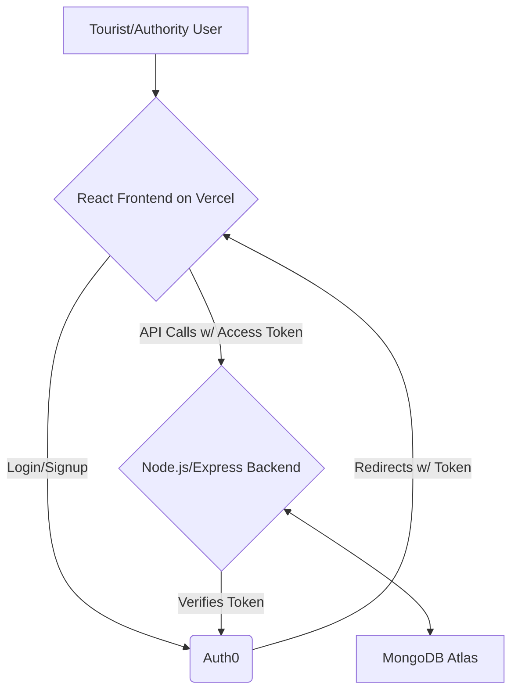

# Sahyatri (सहयात्री) - Smart Tourist Safety System 🛡️

**Sahyatri** (meaning "fellow traveler" in Hindi) is a modern, full-stack web application designed to enhance tourist safety through real-time monitoring, role-based access, and incident response management. This project leverages a powerful combination of technologies including React, Node.js, MongoDB, and Auth0 to create a robust and secure platform for both tourists and authorities.

This project was developed as a comprehensive B.Tech project, showcasing a full-stack architecture with secure authentication, a real-time API, and a dynamic, multilingual user interface.

---

## ✨ Key Features

The application is divided into two main portals, each with a distinct set of features:

###  For Tourists
* **Secure Authentication:** Log in or sign up seamlessly and securely using Auth0, with support for social providers like Google.
* **Interactive Map:** A live map view showing key zones, nearby places, and eventually, real-time user locations.
* **Dynamic Zone Alerts:** Receive a full-screen visual and audio warning if you enter a designated high-risk ("Red") zone.
* **Nearby Places:** View a list of interesting tourist spots in the vicinity.
* **File a Complaint:** A dedicated form to submit complaints about specific zones, which are then stored in the database for review.
* **Panic Button & Modal:** An easily accessible SOS button that can trigger an alert and provides an option to call emergency services.
* **Multilingual Support:** The user interface is fully translatable between English and Hindi, powered by i18next.
* **Progressive Web App (PWA):** The app is installable on mobile devices for a native-like experience.

### For Authorities
* **Role-Based Access Control:** A separate, secure dashboard accessible only to users with the "Authority" role, verified by Auth0.
* **Live Monitoring Dashboard:** A central command center displaying key statistics and a live map of all zones.
* **Zone Status Control:** Authorities can dynamically change the status of a zone (e.g., from "Warning" to "Danger" during an emergency), which is reflected in real-time.
* **Manage Complaints:** (Future Scope) A dedicated panel to view and manage complaints filed by tourists.
* **Responsive Design:** The dashboard is designed to be accessible on both desktop and mobile devices.

---

## 🛠️ Tech Stack & Architecture

This project follows a modern, decoupled full-stack architecture.

| Category         | Technology                                                                                                                              |
| ---------------- | --------------------------------------------------------------------------------------------------------------------------------------- |
| **Frontend** | **React**, **Vite**, **Tailwind CSS**, **Framer Motion**, **Leaflet** (for maps), **i18next** (for translations)                               |
| **Backend** | **Node.js**, **Express.js**, **Mongoose** (for MongoDB ODM)                                                                            |
| **Database** | **MongoDB Atlas** |
| **Authentication**| **Auth0** (for secure login, role-based access, and M2M authentication)                                                              |
| **Deployment** | **Vercel** (Frontend), **Render** (Backend - Recommended)                                                                                  |

### Architecture Diagram

### 🔮 Future Scope
This project provides a solid foundation that can be extended with more advanced features:
- **Real-time Alerts**: Implement the Socket.IO functionality to push live panic alerts to the authority dashboard without needing a refresh.
- **Live Tourist Tracking**: Show the real-time GPS location of tourists on the authority map.
- **AI Anomaly Detection**: Integrate a machine learning model on the backend to automatically detect anomalies like prolonged inactivity or sudden route deviations.
- **IoT Integration**: Add a support for IoT wearables for tourists in areas with poor mobile connectivity.
